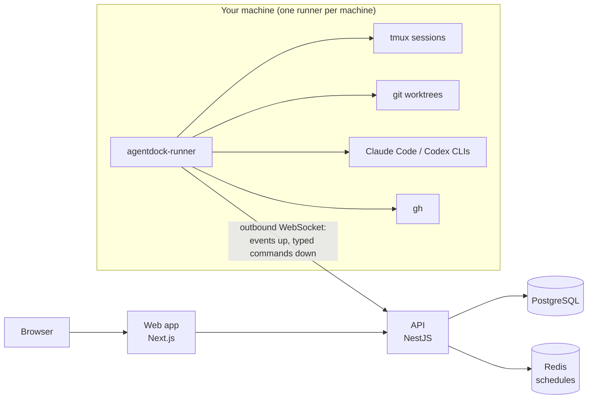

# AgentDock

**One place to see, steer, approve and pay for every AI coding agent you run.**

**[agentdock.luna-realm.com](https://agentdock.luna-realm.com/)**: what AgentDock is, at a glance.

[](https://agentdock.luna-realm.com/)
[](LICENSE)
[](https://www.npmjs.com/package/agentdock-runner)
[](https://www.npmjs.com/package/@andrewbehma/glass-ui)
[](https://discord.gg/mkQARkBs4C)

You run several AI coding agents — Claude Code and Codex — across many
repositories and more than one machine. AgentDock shows every agent, every pull
request and every dollar in one web app, and lets you start, stop, approve and
schedule them without opening a terminal.

It is a self-hosted control plane for agent fleets driven by the
[Code Sentinel](https://github.com/AndreyBegma/code-sentinel-skills) orchestrator.
Without it, a fleet is a pile of tmux sessions, git worktrees, markdown files
inside `.git` and GitHub labels — per project, per machine. Nothing shows the
whole fleet, nothing remembers what ran, and nothing records what it cost.

**Who it is for:** a developer or a small team that runs coding agents
unattended on their own machines and wants to watch them, steer them and keep
their spend in check from one screen.

## What you get

Every item below is built and merged. Each links the specification it was built
from.

**Watch the fleet**

- **Fleet** — every orchestrator slot on every project: issue, branch, runtime,
  model, last checkpoint, pull request and its checks, and whether it is idle,
  out of quota or waiting at a prompt ([spec](docs/specs/11-fleet-observation.md),
  [events](docs/specs/16-consume-code-sentinel-events.md)).
- **Live pane** — a worker's terminal, streamed read-only into the browser
  ([spec](docs/specs/18-live-worker-pane.md)). Admins can attach and type into it;
  every attach is audited ([spec](docs/specs/29-terminal-attach.md)).
- **Activity and history** — one live feed of everything that happened across
  projects, and a record of every round, slot and run with its outcome, pull
  request, tokens and cost ([spec](docs/specs/21-activity-feed-and-history.md)).

**Steer it**

- **Orchestrator control** — start, stop, `next` and `status` per project
  through a runtime profile; stop a slot; message a worker
  ([spec](docs/specs/17-orchestrator-and-slot-control.md)).
- **Queue** — the project's GitHub issues with the ready label, each with its
  computed state (ready, in flight, blocked on work, blocked on a person, no
  spec); create an issue from the UI ([spec](docs/specs/19-task-queue.md)).
- **Approvals** — a per-project switch: green pull requests wait for Approve or
  Request changes instead of merging themselves
  ([spec](docs/specs/20-merge-approval-queue.md)).

**Count the cost**

- **Sessions, tokens and cost** — Claude Code and Codex sessions as a tree of
  turns, LLM requests, tools and subagents, each priced at API-equivalent cost
  from a versioned price table; usage by project, issue, slot, model, runtime
  and day
  ([sessions](docs/specs/12-agent-sessions.md),
  [cost](docs/specs/13-tokens-and-cost.md)).
- **Budgets** — per project or per user, per day, week or month; alert at
  thresholds, or stop new orchestrator and skill runs at the limit
  ([spec](docs/specs/28-budgets.md)).

**Automate**

- **Skills** — browse the [skills.sh](https://skills.sh) catalog, install a
  skill to a project or a runtime profile, and run it on a project in its own
  worktree; the result is a report or a pull request
  ([spec](docs/specs/24-skills.md)).
- **Schedules** — cron for skill runs and orchestrator commands, with a
  missed-run policy; backed by BullMQ on Redis
  ([spec](docs/specs/25-cron-schedules.md),
  [BullMQ](docs/specs/123-schedules-on-bullmq.md)).
- **Webhooks** — signed inbound triggers that run a skill or wake the
  orchestrator, and signed, retried outbound deliveries with a delivery log
  ([spec](docs/specs/26-webhooks.md)).
- **GitHub App** — issue, pull request and check events pushed to AgentDock
  instead of polled ([spec](docs/specs/27-github-app.md)).
- **Notifications and Telegram** — an in-app notification centre and a Telegram
  bot for the things only a person can clear: a question, a gate, a prompt, a
  merge to approve, a budget hit ([spec](docs/specs/22-notifications-and-telegram.md)).

**Stay in control**

- **Roles** — local accounts; the first admin is created from the command line,
  new accounts wait for an admin's approval; roles admin, operator and viewer,
  with per-project access ([spec](docs/specs/3-auth-and-access.md)).
- **Audit** — an append-only, hash-chained log of every privileged action, with
  before and after ([spec](docs/specs/8-audit-log.md)).

## How it works



The control plane (web, API, database) can run anywhere. Each machine that
holds repositories runs one runner. The runner dials out to the API, so the
machine needs no open port. Three decisions shape everything else:

- **The control plane never reads a project's filesystem; the runner does**
  ([ADR-0001](docs/adr/0001-control-plane-and-per-machine-runner.md)).
- **The runner executes a typed command allowlist** — never an arbitrary shell
  command ([ADR-0010](docs/adr/0010-typed-command-allowlist-on-the-runner.md)).
- **GitHub issues are the task queue** — AgentDock has no tracker of its own
  ([ADR-0004](docs/adr/0004-github-issues-are-the-task-queue.md)).

The architecture is in [docs/architecture/overview.md](docs/architecture/overview.md).

## Quick start (local)

Requirements: [Bun](https://bun.sh) 1.4.0+, Node.js 24+, Docker (for
PostgreSQL and Redis).

```sh
git clone https://github.com/AndreyBegma/AgentDock && cd AgentDock
bun install

# Environment: the examples work as they are for local development.
cp docker/.env.example docker/.env
cp apps/api/.env.example apps/api/.env
cp apps/web/.env.example apps/web/.env

bun run db:setup       # PostgreSQL on :5421, Redis on :6421, migrations, seed
bun run admin:create   # the first admin; the seed creates no users
bun run start:dev      # API on http://localhost:8180, web on http://localhost:3517
```

Open http://localhost:3517 and sign in as the admin. `curl
http://localhost:8180/health` checks the API.

The passwords in `docker/.env` must match `DATABASE_URL` and `REDIS_URL` in
`apps/api/.env`; the examples already agree. Every variable is documented in
its `.env.example`.

Next, put a runner on the machine that holds your repositories.

## Install the runner

The runner is a single binary, published as [packages](#packages) for
`darwin-arm64`, `darwin-x64`, `linux-x64` and `linux-arm64`
([ADR-0017](docs/adr/0017-runner-distribution-homebrew-and-npm.md)). First,
get a one-time pairing code in the web app: **Admin → Runners → Add runner**.

**Homebrew** (macOS and Linux):

```sh
brew install andreybegma/tap/agentdock-runner
agentdock-runner pair --server <api-origin> --code XXXX-XXXX
brew services start agentdock-runner
```

**npm** (or `bun add -g agentdock-runner`):

```sh
npm i -g agentdock-runner
agentdock-runner pair --server <api-origin> --code XXXX-XXXX
agentdock-runner install-service
```

`install-service` writes a systemd user unit on Linux or a launchd agent on
macOS, and prints the command that starts it.

**From source** (needs Bun): `bun run build` in this repository produces
`apps/runner/dist/agentdock-runner`.

`<api-origin>` is the API, not the web app: `http://localhost:8180` for the
local quick start, `https://<host>/api` behind the reference proxy. `pair` also
detects the machine's Claude Code and Codex runtime profiles.

Every AgentDock server serves a public **`/install`** page
(http://localhost:3517/install locally) with these steps for that server.
Commands, files and options are in [apps/runner/README.md](apps/runner/README.md).

## Packages

| Package | What it is |
|---|---|
| [`agentdock-runner`](https://www.npmjs.com/package/agentdock-runner) | The runner daemon on npm. It is laid out like esbuild: a thin package that pulls the one prebuilt binary for your platform through `optionalDependencies` on `agentdock-runner-{darwin,linux}-{arm64,x64}`. |
| [`andreybegma/tap/agentdock-runner`](https://github.com/AndreyBegma/homebrew-tap) | The Homebrew formula: `brew install andreybegma/tap/agentdock-runner`. |
| [Runner releases](https://github.com/AndreyBegma/AgentDock/releases?q=runner-v&expanded=true) | GitHub Releases tagged `runner-v*`, with the four prebuilt binaries as tarballs and `SHA256SUMS`. |
| [`@andrewbehma/glass-ui`](https://www.npmjs.com/package/@andrewbehma/glass-ui) | The design system the web app is built on ([AndreyBegma/glass-ui](https://github.com/AndreyBegma/glass-ui)). |

How a runner release is cut is in
[deploy/README.md](deploy/README.md#releasing-the-runner).

## Deploying

There is no one-command production installer yet. The reference self-host
recipe is the staging deployment, described in
[deploy/README.md](deploy/README.md) and decided in
[ADR-0016](docs/adr/0016-staging-on-the-agent-host-behind-a-cloudflare-tunnel.md):

- **Docker Compose** runs the API, the web app, PostgreSQL and Redis
  ([deploy/staging/docker-compose.yml](deploy/staging/docker-compose.yml)).
- **Caddy** gives them one origin: `/api/*` goes to the API, WebSockets
  included, and everything else to the web app
  ([Caddyfile](deploy/staging/Caddyfile)).
- **A Cloudflare tunnel** (cloudflared) publishes that origin, so nothing is
  exposed on the host.
- The API applies migrations and the seed in its entrypoint. Secrets are
  generated on the host on the first run, and the first admin is created with
  the same `admin:create` CLI inside the API container.

## Repository layout

Bun workspaces and Turborepo.

| Path | Package | Stack |
|---|---|---|
| [`apps/api`](apps/api) | `@agentdock/api` | NestJS 11, Prisma 7, PostgreSQL 16, BullMQ on Redis 7 — port 8180 |
| [`apps/web`](apps/web) | `@agentdock/web` | Next.js 16 (App Router), React 19, Tailwind CSS 4 — port 3517 |
| [`apps/runner`](apps/runner) | `@agentdock/runner`, published as `agentdock-runner` | Bun, compiled to a single binary |
| [`packages/shared`](packages/shared) | `@agentdock/shared` | framework-free TypeScript shared by the API, the web app and the runner |
| [`docker`](docker) | — | PostgreSQL and Redis for local development |
| [`deploy`](deploy) | — | the staging stack, the CI image, release notes |

The UI uses only components from
[`@andrewbehma/glass-ui`](https://www.npmjs.com/package/@andrewbehma/glass-ui);
a missing component is added to glass-ui, not written here
([ADR-0011](docs/adr/0011-glass-ui-is-the-component-library.md)).

## Development

| Command | What it does |
|---|---|
| `bun run start:dev` | API and web in watch mode |
| `bun run check` | Biome lint, format and import order, without writing |
| `bun run test` | the test suites |
| `bun run build` | build everything (Turborepo, cached) |
| `bun run db:setup` | start PostgreSQL and Redis, apply migrations, seed |
| `bun run db:migrate` | `prisma migrate dev`: create and apply a migration |
| `bun run db:generate` | regenerate the Prisma client |
| `bun run db:studio` | Prisma Studio |

Conventions, in brief (the full list is in [CLAUDE.md](CLAUDE.md)):

- **Bun** is the package manager, with versions pinned exactly.
- **Biome** is the only linter and formatter.
- **TypeScript** is strict everywhere, with no `any`.
- Every API input is a DTO validated with `class-validator`.
- Tests sit next to the code as `*.spec.ts`. A bug fix comes with the test that
  would have caught it.
- Prisma is used only by `apps/api`. The web app talks to the API over HTTP.
- An architectural change records a new ADR in the same pull request.

CI runs on Woodpecker. A pull request runs `check` and `build`, and tests only
the packages it changed plus their dependents
([ADR-0018](docs/adr/0018-pull-requests-test-what-changed.md)). Pull requests
target `develop`; a push to `develop` deploys staging.

New `@andrewbehma/glass-ui` releases arrive as pull requests into `develop`
from Renovate ([`renovate.json`](renovate.json)). Renovate watches only that
package, pinned exactly, and a person merges its pull requests. Every other
dependency is updated by hand.

## Documentation

[`docs/`](docs/README.md) is the authority on what AgentDock is and how it is
built.

| Folder | What lives there |
|---|---|
| [`docs/product`](docs/product) | the [PRD](docs/product/prd.md), the [glossary](docs/product/glossary.md), the [roadmap](docs/product/roadmap.md) |
| [`docs/architecture`](docs/architecture) | the [overview](docs/architecture/overview.md), the [runner protocol](docs/architecture/runner-protocol.md), the [event schema](docs/architecture/event-schema.md), the [data model](docs/architecture/data-model.md), [security](docs/architecture/security.md), the [cost model](docs/architecture/cost-model.md), the [GitHub App](docs/architecture/github-app.md) |
| [`docs/adr`](docs/adr) | architecture decision records, numbered; superseded, never rewritten |
| [`docs/specs`](docs/specs) | one specification per issue |
| [`docs/ui`](docs/ui) | [glass-ui usage](docs/ui/glass-ui.md) and [screens](docs/ui/screens.md) |
| [`docs/plugin`](docs/plugin) | [changes AgentDock needs in Code Sentinel](docs/plugin/code-sentinel-changes.md) |

## Roadmap

Milestones M1 (see the fleet), M2 (steer it) and M3 (automate) are built. Next
is **M4 — Codex in the fleet**, which is **not built yet**: Codex workers in
orchestrator slots, fenced by their own worktree, sandbox and a pre-merge
ownership check ([ADR-0013](docs/adr/0013-codex-workers-and-their-fence.md)),
then Codex as the orchestrator. Today Codex sessions are read, priced and shown,
and skills install for Codex profiles; orchestrator slots run Claude Code. The
full plan is in [docs/product/roadmap.md](docs/product/roadmap.md).

## License

[MIT](LICENSE)
