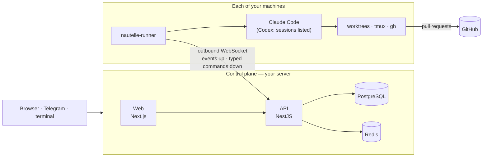
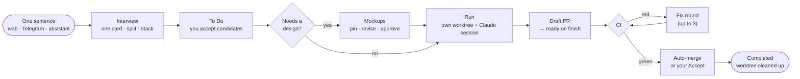

<div align="center">

<picture>
  <source media="(prefers-color-scheme: dark)" srcset="docs/assets/logo-dark.svg">
  
</picture>

**One place to see, steer, approve and pay for every AI coding agent you run.**

_Nautelle, formerly AgentDock._

[](https://github.com/AndreyBegma/Nautelle/releases)
[](https://ci.luna-realm.com/repos/9)
[](LICENSE)
[](https://github.com/AndreyBegma?tab=packages&repo_name=Nautelle)
[](https://hub.docker.com/u/abegma)
[](https://www.npmjs.com/package/nautelle-runner)
[](https://andreybegma.github.io/Nautelle/)

[**Documentation**](https://andreybegma.github.io/Nautelle/) ·
[Install](https://andreybegma.github.io/Nautelle/getting-started/install/) ·
[Concepts](https://andreybegma.github.io/Nautelle/concepts/board/) ·
[Wiki](https://github.com/AndreyBegma/Nautelle/wiki) ·
[Website](https://nautelle.luna-realm.com/)

</div>

<picture>
  <source media="(prefers-color-scheme: dark)" srcset="docs/assets/hero-dark.svg">
  
</picture>

Nautelle is a **self-hosted control plane for Claude Code agent fleets**. You
describe work in one sentence. Nautelle interviews you, turns the answer into
cards, can draw a design for them and runs a dedicated agent per card on your
own machines. Each agent opens a pull request and fixes its own CI. You stay in
charge of what merges, what it costs and what an agent may do — from the
browser, from Telegram or from the terminal you already use.

It works alongside the [Code Sentinel](https://github.com/AndreyBegma/code-sentinel-skills)
orchestrator, and GitHub issues and pull requests stay the source of truth.

## Quick start

To try it, one container is enough:

```sh
docker run -p 8000:8000 -v nautelle:/data abegma/nautelle
```

It runs a demo PostgreSQL and Redis inside, so it is **not for production**.
Open the setup link it prints to create the first administrator. The
[install guide](https://andreybegma.github.io/Nautelle/getting-started/install/#try-it-in-one-container)
has the details.

To install it for real, on a Linux host with Docker:

```sh
curl -fsSL https://raw.githubusercontent.com/AndreyBegma/Nautelle/main/deploy/compose/install.sh | sh
```

1. Run the command above. It writes a Docker Compose stack into `./nautelle`
   and starts it.
2. Open <http://localhost:8000>.
3. Create the first administrator on the setup page.

The images are on ghcr.io (`ghcr.io/andreybegma/nautelle-*`, the default) and
on Docker Hub as `abegma/nautelle-api`, `abegma/nautelle-web` and
`abegma/nautelle`, with the same digests and signatures. Add
`--registry docker.io/abegma` to pull them from Docker Hub.

Then pair a runner on the machine that holds your repositories, with a code
from **Admin › Runners › Add runner**:

```sh
brew install andreybegma/tap/nautelle-runner      # or: npm i -g nautelle-runner
nautelle-runner pair --server http://localhost:8000/api --code XXXX-XXXX --allow-root ~/dev
nautelle-runner install-service
```

`--tunnel-token` puts the install behind a Cloudflare tunnel and `--domain`
serves your own domain with automatic HTTPS. The
[install guide](https://andreybegma.github.io/Nautelle/getting-started/install/)
covers the three modes, the
[requirements](https://andreybegma.github.io/Nautelle/getting-started/requirements/),
[upgrades](https://andreybegma.github.io/Nautelle/operations/upgrade/) and
[backups](https://andreybegma.github.io/Nautelle/operations/backup/).

On Kubernetes, the Helm chart runs the control plane; runners stay on the
developer machines:

```sh
helm install nautelle oci://ghcr.io/andreybegma/charts/nautelle --version X.Y.Z \
  -n nautelle --create-namespace
```

Values, Ingress, external databases and backups are in
**[Kubernetes (Helm)](https://andreybegma.github.io/Nautelle/operations/kubernetes/)**.

## Features

| | |
|---|---|
| **[Board and cards](https://andreybegma.github.io/Nautelle/concepts/board/)** | A per-project board (Inbox → To Do → In progress → Finished → Completed). Cards have dependencies and Auto-run, and support bulk actions. |
| **[New work intake](https://github.com/AndreyBegma/Nautelle/wiki/New-Work-Intake)** | One sentence goes in. A short interview follows. Out comes one card, a split or a staged stack, and you accept it before anything runs. |
| **[Design and stacks](https://andreybegma.github.io/Nautelle/concepts/stacks/)** | HTML mockups drawn from your project's UI profile, with pinned comments, revisions and approval. A stack shares one design. |
| **[Card workers and shipping](https://github.com/AndreyBegma/Nautelle/wiki/Card-Workers-and-Shipping)** | Each card gets its own worktree and Claude session. It opens a draft PR, fixes red CI on its own and can auto-merge. |
| **[Fleet and orchestrator](https://andreybegma.github.io/Nautelle/concepts/fleet/)** | Code Sentinel slots, the queue of ready issues, PR approvals, a live terminal pane and an audited terminal attach. |
| **[Sessions, usage and budgets](https://github.com/AndreyBegma/Nautelle/wiki/Sessions-Usage-and-Budgets)** | Every session is shown as a tree of turns, tools and subagents, priced at API-equivalent cost. Budgets can alert or stop new runs. |
| **[Token Saver](https://github.com/AndreyBegma/Nautelle/wiki/Token-Saver)** | Agents read less: command output is filtered, oversized and repeated reads are guarded, history is compacted early, and the savings are measured. |
| **[Steward](https://github.com/AndreyBegma/Nautelle/wiki/Steward)** | Spots stuck agent work, applies the few fixes that are safe and asks a person for the rest. |
| **[Context handoff](https://github.com/AndreyBegma/Nautelle/wiki/Context-Handoff)** | A short note per card, so the next round or session starts in context and costs less. |
| **[Claude Code integration](https://github.com/AndreyBegma/Nautelle/wiki/Claude-Code-Integration)** | A plugin with MCP tools and hooks. Terminal sessions appear on the board, and away mode sends permission prompts to your phone. |
| **[Telegram](https://github.com/AndreyBegma/Nautelle/wiki/Telegram)** | Browse, run and accept cards, answer agents, approve PRs and send voice notes. A Mini App opens the board. |
| **[AI assistant](https://github.com/AndreyBegma/Nautelle/wiki/AI-Assistant)** | A floating chat on every page that reads your board and fleet and drafts cards. It uses your own provider keys and spend caps. |
| **[Automation](https://github.com/AndreyBegma/Nautelle/wiki/Automation)** | Skills from skills.sh, cron schedules, signed webhooks and a GitHub App. |
| **[Security and access](https://andreybegma.github.io/Nautelle/concepts/runner-security/)** | Roles, an approval-gated sign-up and a hash-chained audit log. The runner keeps a local policy the server cannot change. |

> [!NOTE]
> Orchestrator slots and card workers run **Claude Code** today. Codex sessions
> are listed, but Codex workers are the next milestone and are not built yet
> ([roadmap](docs/product/roadmap.md)).

## How it works



- **The control plane never reads a project's filesystem.** A runner on each
  machine does, and it dials out, so the machine needs no open port
  ([ADR-0001](docs/adr/0001-control-plane-and-per-machine-runner.md)).
- **The runner runs typed commands from an allowlist** and refuses anything
  outside the folders you allowed, under a local policy the server cannot
  change ([ADR-0010](docs/adr/0010-typed-command-allowlist-on-the-runner.md),
  [ADR-0047](docs/adr/0047-a-runner-local-security-policy-the-server-cannot-change.md)).
- **Code and credentials stay on your machines.** Claude Code and GitHub
  credentials never reach the server.

A card goes from an idea to a merged pull request like this:



## Documentation

| Where | What |
|---|---|
| [**Documentation site**](https://andreybegma.github.io/Nautelle/) | Install, configuration (every environment variable), operations (upgrade, backup, reverse proxy, troubleshooting, privacy) and concepts |
| [**Wiki**](https://github.com/AndreyBegma/Nautelle/wiki) | Feature guides and FAQ |
| [`docs/`](docs/README.md) | The engineering source of truth: [ADRs](docs/adr), [specs](docs/specs), [architecture](docs/architecture), [product](docs/product) |
| [`apps/runner`](apps/runner/README.md) | Runner commands, files and environment |
| [`deploy/`](deploy/README.md) | CI pipelines, image, runner and docs releases |

## Contributing

Pull requests target `develop`. Read **[CONTRIBUTING.md](CONTRIBUTING.md)**
and [CLAUDE.md](CLAUDE.md) for the conventions; help is in [SUPPORT.md](SUPPORT.md),
vulnerabilities go through [SECURITY.md](SECURITY.md). An architectural change records
a new ADR in the same pull request.

To work on Nautelle itself you need [Bun](https://bun.sh) 1.4.0+, Node.js 24+
and Docker:

```sh
git clone https://github.com/AndreyBegma/Nautelle && cd Nautelle
bun install
cp apps/web/.env.example apps/web/.env

bun run db:setup       # docker/.env + apps/api/.env with generated passwords, PostgreSQL 127.0.0.1:5421, Redis 127.0.0.1:6421, migrations, seed
bun run admin:create   # the first admin
bun run start:dev      # API http://localhost:8180 · web http://localhost:3517
bun run docs:dev       # the documentation site at http://localhost:4321/Nautelle/
```

Pair a development runner with `--server http://localhost:8180`.

## License

[MIT](LICENSE)
