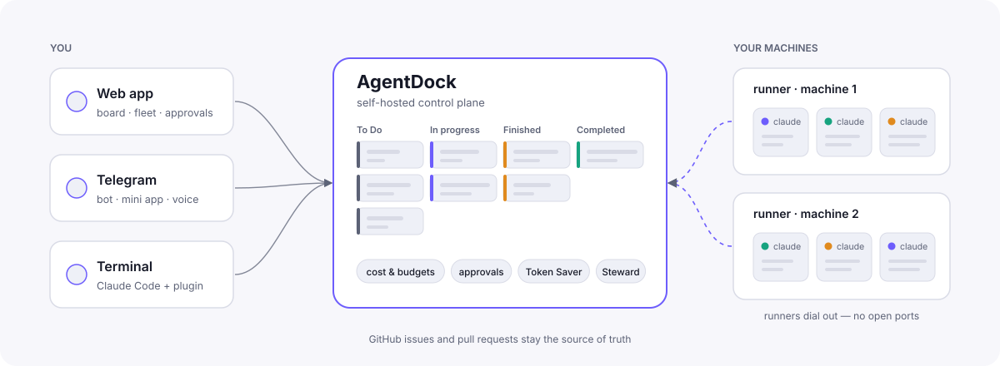
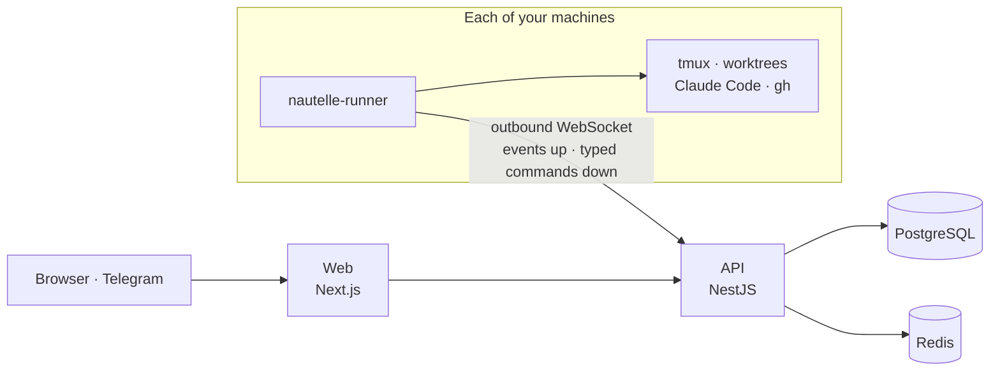

<div align="center">

# Nautelle

_Nautelle, formerly AgentDock._

**One place to see, steer, approve and pay for every AI coding agent you run.**

[](https://nautelle.luna-realm.com/)
[](https://github.com/AndreyBegma/Nautelle/wiki)
[](LICENSE)
[](https://www.npmjs.com/package/nautelle-runner)

[**Wiki**](https://github.com/AndreyBegma/Nautelle/wiki) ·
[Getting started](https://github.com/AndreyBegma/Nautelle/wiki/Getting-Started) ·
[How work flows](https://github.com/AndreyBegma/Nautelle/wiki/How-Work-Flows) ·
[Token Saver](https://github.com/AndreyBegma/Nautelle/wiki/Token-Saver) ·
[Self-hosting](https://github.com/AndreyBegma/Nautelle/wiki/Self-Hosting) ·
[Architecture](https://github.com/AndreyBegma/Nautelle/wiki/Architecture)

</div>

<picture>
  <source media="(prefers-color-scheme: dark)" srcset="docs/assets/hero-dark.svg">
  
</picture>

Nautelle is a **self-hosted control plane for Claude Code agent fleets**. You
describe work in one sentence. Nautelle interviews you, turns the answer into
cards, can draw a design for them and runs a dedicated agent per card on your
own machines. Each agent opens a pull request and fixes its own CI. You stay in
charge of what merges, what it costs and what an agent may do. You do this from
the browser, from Telegram or from the terminal you already use.

It works alongside the [Code Sentinel](https://github.com/AndreyBegma/code-sentinel-skills)
orchestrator, and GitHub issues and pull requests stay the source of truth.

## Features

| | |
|---|---|
| **[Board and cards](https://github.com/AndreyBegma/Nautelle/wiki/Board-and-Cards)** | A per-project board (To Do → In progress → Finished → Completed). Cards have dependencies and Auto-run, and support bulk actions. |
| **[New work intake](https://github.com/AndreyBegma/Nautelle/wiki/New-Work-Intake)** | One sentence goes in. A short interview follows. Out comes one card, a split or a staged stack, and you accept it before anything runs. |
| **[Design and stacks](https://github.com/AndreyBegma/Nautelle/wiki/Design-and-Stacks)** | HTML mockups drawn from your project's UI profile, with pinned comments, revisions and approval. A stack shares one design. |
| **[Card workers and shipping](https://github.com/AndreyBegma/Nautelle/wiki/Card-Workers-and-Shipping)** | Each card gets its own worktree and Claude session. It opens a draft PR, fixes red CI on its own and can auto-merge. |
| **[Fleet and orchestrator](https://github.com/AndreyBegma/Nautelle/wiki/Fleet-and-Orchestrator)** | Code Sentinel slots, the queue of ready issues, PR approvals, a live terminal pane and an audited terminal attach. |
| **[Sessions, usage and budgets](https://github.com/AndreyBegma/Nautelle/wiki/Sessions-Usage-and-Budgets)** | Every session is shown as a tree of turns, tools and subagents, priced at API-equivalent cost. Budgets can alert or stop new runs. |
| **[Token Saver](https://github.com/AndreyBegma/Nautelle/wiki/Token-Saver)** | Agents read less: command output is filtered, oversized and repeated reads are guarded, history is compacted early, and the savings are measured. |
| **[Steward](https://github.com/AndreyBegma/Nautelle/wiki/Steward)** | Spots stuck agent work, applies the few fixes that are safe and asks a person for the rest. |
| **[Context handoff](https://github.com/AndreyBegma/Nautelle/wiki/Context-Handoff)** | A short note per card, so the next round or session starts in context and costs less. |
| **[Claude Code integration](https://github.com/AndreyBegma/Nautelle/wiki/Claude-Code-Integration)** | A plugin with MCP tools and hooks. Terminal sessions appear on the board, and away mode sends permission prompts to your phone. |
| **[Telegram](https://github.com/AndreyBegma/Nautelle/wiki/Telegram)** | Browse, run and accept cards, answer agents, approve PRs and send voice notes. A Mini App opens the board. |
| **[AI assistant](https://github.com/AndreyBegma/Nautelle/wiki/AI-Assistant)** | A floating chat on every page that reads your board and fleet and drafts cards. It uses your own provider keys and spend caps. |
| **[Automation](https://github.com/AndreyBegma/Nautelle/wiki/Automation)** | Skills from skills.sh, cron schedules, signed webhooks and a GitHub App. |
| **[Security and access](https://github.com/AndreyBegma/Nautelle/wiki/Security-and-Access)** | Roles, an approval-gated sign-up and a hash-chained audit log. The runner keeps a local policy the server cannot change. |

> [!NOTE]
> Orchestrator slots and card workers run **Claude Code** today. Codex sessions
> are listed, but Codex workers are the next milestone and are not built yet
> ([roadmap](docs/product/roadmap.md)).

## How work flows


The full walkthrough is in **[How work flows](https://github.com/AndreyBegma/Nautelle/wiki/How-Work-Flows)**.

## How it is built



- **The control plane never reads a project's filesystem.** A runner on each
  machine does, and it dials out, so the machine needs no open port
  ([ADR-0001](docs/adr/0001-control-plane-and-per-machine-runner.md)).
- **The runner runs typed commands from an allowlist.** It never runs a shell
  string ([ADR-0010](docs/adr/0010-typed-command-allowlist-on-the-runner.md)).
- **GitHub is the task queue for the fleet.** Board cards belong to Nautelle
  ([ADR-0004](docs/adr/0004-github-issues-are-the-task-queue.md),
  [ADR-0024](docs/adr/0024-board-cards-and-dedicated-card-workers.md)).

More in **[Architecture](https://github.com/AndreyBegma/Nautelle/wiki/Architecture)**.

## Install

On a host with Docker, one command runs Nautelle from its published images at
<http://localhost:8000>:

```sh
curl -fsSL https://raw.githubusercontent.com/AndreyBegma/Nautelle/main/deploy/compose/install.sh | sh
```

`--tunnel-token` puts it behind a Cloudflare tunnel and `--domain` serves a
domain with automatic HTTPS. The first administrator, upgrades, backups and
runner pairing are in **[Installing Nautelle](docs/guides/install.md)**.

## Quick start

To work on Nautelle itself. Requirements: [Bun](https://bun.sh) 1.4.0+,
Node.js 24+ and Docker.

```sh
git clone https://github.com/AndreyBegma/Nautelle && cd Nautelle
bun install
cp apps/web/.env.example apps/web/.env

bun run db:setup       # docker/.env + apps/api/.env with generated passwords, PostgreSQL 127.0.0.1:5421, Redis 127.0.0.1:6421, migrations, seed
bun run admin:create   # the first admin
bun run start:dev      # API http://localhost:8180 · web http://localhost:3517
```

Then pair a runner on the machine that holds your repositories. Get a code at
**Admin › Runners › Add runner**:

```sh
brew install andreybegma/tap/nautelle-runner      # or: npm i -g nautelle-runner
nautelle-runner pair --server http://localhost:8180 --code XXXX-XXXX --allow-root ~/dev
nautelle-runner install-service
```

Step-by-step guides:
**[Getting started](https://github.com/AndreyBegma/Nautelle/wiki/Getting-Started)**,
**[Installing the runner](https://github.com/AndreyBegma/Nautelle/wiki/Installing-the-Runner)**
and **[Self-hosting](https://github.com/AndreyBegma/Nautelle/wiki/Self-Hosting)**.

## Documentation

| Where | What |
|---|---|
| [**Wiki**](https://github.com/AndreyBegma/Nautelle/wiki) | User guides: setup, every feature, self-hosting, FAQ |
| [`docs/`](docs/README.md) | The engineering source of truth: [ADRs](docs/adr), [specs](docs/specs), [architecture](docs/architecture), [product](docs/product) |
| [`apps/runner`](apps/runner/README.md) | Runner commands, files and environment |
| [`deploy/`](deploy/README.md) | CI pipelines, the reference deployment, runner and image releases |
| [Install guide](docs/guides/install.md) | Running Nautelle from the published images: modes, upgrade, backup |

## Contributing

Pull requests target `develop`. Read **[Contributing](https://github.com/AndreyBegma/Nautelle/wiki/Contributing)**
and [CLAUDE.md](CLAUDE.md) for the conventions. An architectural change records
a new ADR in the same pull request.

## License

[MIT](LICENSE)
